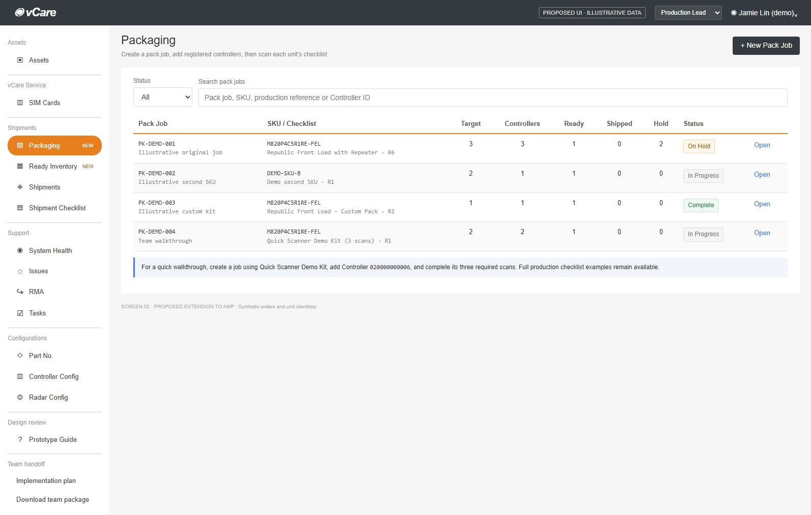
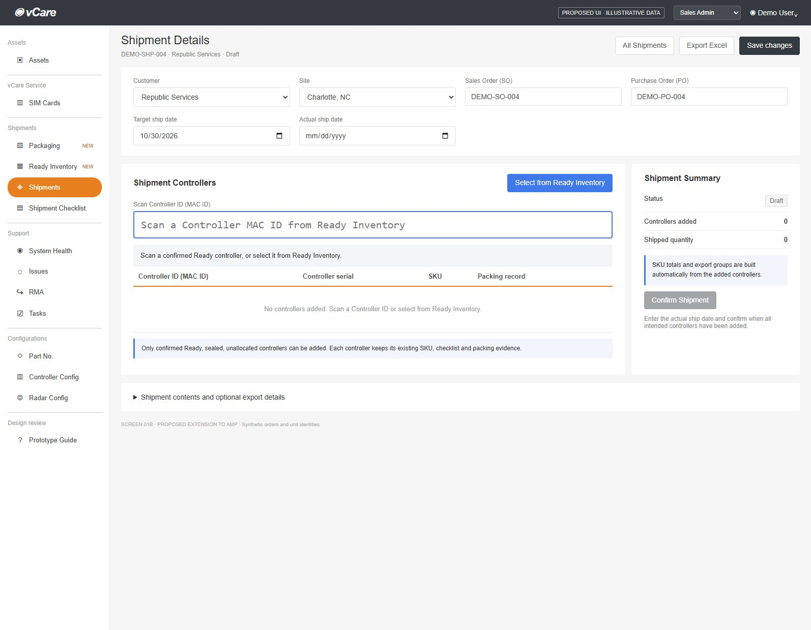
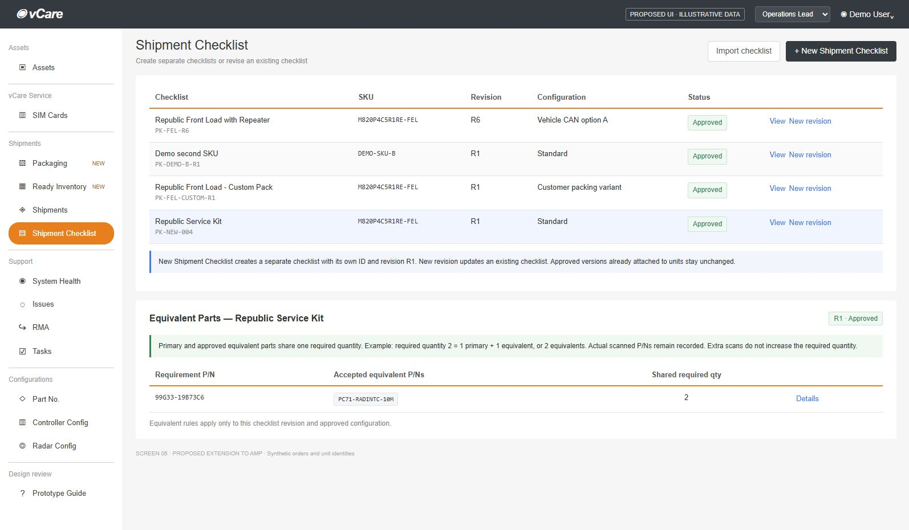

# vCare AMP: two-week implementation

**Target: 10 business days to a controlled production pilot.** Build this as a small extension of AMP. Operators use a PC and a USB barcode scanner configured as keyboard input with Enter or Tab. No phone or camera scanning is in scope.

## What the team will deliver

- New Pack Job selects an approved checklist, target unit quantity and optional production reference. Add registered Controller MAC IDs, then open an independent, initially empty scan session for each unit. Packing accepts scans and marks completed units Ready. Ready Inventory shows the verifier’s name and date/time in the table, linked to sign-off history.
- New Shipment Checklist creates a separate checklist ID at R1, blank or copied from an existing checklist. New revision updates an existing checklist. Define required parts/quantities and equivalents; keep actual scanned P/Ns.
- Each shipment supports mixed SKUs and packing configurations. Adding a Controller ID retains its verified packing record and automatically groups contents by SKU/checklist/configuration; the same SKU can have different checklists.
- Justin can view all shipments, search SO/PO/customer/site/MAC, filter by customer, and sort by customer or ship date. Create with existing Customer/Site dropdowns, SO, PO and target date. Then scan Controller IDs or select them from confirmed Ready Inventory; no SKU, checklist or packing-list choice is required.
- Excel export: tracking blocks like the supplied screenshot plus a filterable unit list. Include target/actual ship dates, SO, PO, P/N, target/shipped quantities, location, and MAC IDs. Retain original Taiwan serial history and reviews.

**Checklist setup:** Sales Admin or Production Lead can prepare a draft. Operations Lead approves it for use. Primary and approved equivalents share one required quantity: qty 2 can be 1 primary + 1 equivalent, or 2 equivalents. Excess scans are rejected.

## One simple workflow

1. **Set up:** Justin selects an existing Customer and its Site, enters SO/PO and target date, and creates the shipment without any lines. The created shipment immediately accepts Controller MAC scans or Ready Inventory selection. Production can also prepare units against an approved checklist before an order is assigned.
2. **Pack:** create a Pack Job with its approved checklist and target quantity. Scan registered Controller MAC IDs into the job; validate SKU, duplicates and capacity. Open each controller to scan required parts, save/resume progress and review serial changes. The job pins the approved checklist version; each controller starts at zero.
3. **Ready:** quantities and reviews are complete; the operator confirms packing/sealing. The server records the signed-in verifier’s user ID and UTC timestamp with the packing attempt, in the same transaction as Ready status.
4. **Ship:** Justin scans Ready Controller MAC IDs or selects controllers from the Ready list. AMP attaches their packing records and calculates SKU quantities automatically. He enters the actual ship date and confirms dispatch. Export the current shipment or the filtered list.

## Keep the implementation small

Reuse AMP's current pages, login, roles, backend language, database, and deployment pipeline. Match its charcoal header, orange navigation, blue actions, and compact tables. Use normal HTTP requests and database transactions; AI helps write and review the code, while scan acceptance follows explicit rules.

**Planning assumption:** two developers using AI, a part-time tester/operations reviewer, same-day checklist decisions, and repository/AWS access on Day 1. Day 10 is a pilot target with release checks, followed by normal support. Full ERP integration, offline mode, phone scanning, and a new identity system are outside this delivery.

<!-- page -->

# The 10-day schedule

| Day | Work | Done when |
| --- | --- | --- |
| 1 | Confirm existing AMP integration; agree sample checklist and equivalents; define fields and states. | Team has one approved example and a working branch/build. |
| 2 | Add separate checklist creation, draft editing/approval, revisions, and equivalent P/N quantity rules. | Each Ready controller retains its approved checklist and packing configuration. |
| 3 | Build import preview and packing scan API; deploy first build to AWS staging. | Original records are preserved; valid, wrong, and equivalent scans behave correctly. |
| 4 | Build New Pack Job, controller binding and desktop scanning with USB input. | Create job, add valid controllers, keep scans separate, save/resume and recover focus on the warehouse PC. |
| 5 | Add completion, quarantine/rework, and serial-change review. | A complete, sealed unit becomes Ready; incomplete units remain blocked. |
| 6 | Build searchable shipment list, creation with SO/PO, Ready Controller picker and direct MAC allocation. | Customer search/sort and both allocation methods work; Ready-state and duplicate checks pass without manual line selection. |
| 7 | Complete dispatch and Excel tracking/unit-list export; run the full flow. | Mixed-checklist shipment exports correct dates, SO/PO, quantities, location and MACs. |
| 8 | Run operator UAT with real scanner and supplied examples; rehearse migration and rollback. | Release checks on page 4 have recorded results. |
| 9 | Fix UAT defects; train operators; prepare the production release. | Operations accepts the pilot checklist; deployment and recovery steps are ready. |
| 10 | Deploy and run a small, supervised production batch. | Packing, allocation, dispatch, history, and export reconcile for the pilot. |

## Ownership

**Developer A:** data, imports, scan rules, allocation, and deployment. **Developer B:** AMP screens, scanner interaction, and exports. Review each other's changes daily. **Operations lead:** approves mappings, equivalent parts, and serial exceptions. **Justin / Sales Admin:** validates shipment search, creation, allocation and Excel output. **Tester:** starts with sample scenarios on Day 1 and leads Days 8–10.

Use a short daily review of the working flow. If the existing AMP integration is harder than expected, keep the pilot to the agreed product/checklist and customer, and defer extra templates or cosmetic changes. Required scan and shipment checks still apply.

<!-- page -->

# Build rules and backend

## Rules that must be enforced

- **Packing evidence follows the Controller ID.** Load its approved checklist/configuration from the confirmed Ready record. Attach that version to the shipment automatically; Justin never chooses a packing list. Keep different checklist versions separate even for the same SKU.
- **Equivalent parts fill the same requirement.** Combine accepted alternatives toward one required quantity, preserve the actual P/N, and block excess scans. Vehicle-specific CAN choices need the applicable vehicle rule; they are not universal aliases.
- **Serials remain traceable.** Preserve Taiwan's original file and serials. Record later observed values as changes with source, time, and user. Unresolved differences hold the unit for review; Amy or the assigned operations reviewer confirms the outcome with a reason. Automatic uploads remain observations and do not prove box contents.
- **Skipped is incomplete.** A missing required component cannot pass. Record missing/backordered items against the requirement and hold the unit. Use Not required only when the approved checklist says so. Preserve historical sample results as imported evidence.
- **Allocation is atomic.** A controller can belong to only one active shipment. In one transaction, the server confirms Ready/sealed/no holds/unallocated, derives its SKU and packing evidence, and creates or matches its shipment group. Validate any existing SO/PO requirements automatically. Dispatch rechecks the allocation. Reopening an allocated box first removes its allocation and Ready status with an audit record.
- **Retries do not add scans twice.** Each scan/import commit carries a request ID. Retrying that request returns its original result. Repeated serials are blocked where the part requires unique serial tracking; ordinary repeated P/N labels can count toward the required quantity.

## Minimal backend change

Use the current AMP framework and database. Add the following records or extend existing ones; these are logical groups, not a requirement to create a new service:

| Record group | Minimum information |
| --- | --- |
| Checklist/version | Checklist ID/name; separate version ID, SKU/configuration, requirements, shared quantities and accepted equivalents. |
| Shipment / line | Header: existing customer_id/site_id, SO, PO, target/actual dates, status. Automatic group: SKU, selected-controller count, checklist/configuration and packing-record references. |
| Pack Job | Job ID, approved checklist version, target quantity, optional reference, creator/time; controller assignments and derived progress. |
| Unit/packing | Unit ID/MAC, job ID, checklist, state, scans, seal; Ready verifier user ID, UTC time, packing-attempt ID and retained sign-off history. |
| Allocation/history | Unit-to-line assignment, dispatch, original and changed serials, reviewer/reason, import source. |

Reuse AMP operations for jobs, registered-controller binding, save/resume, checklist creation/approval/revisions, import preview/commit, scans, completion/reopening, serial review, shipment search/create, allocation, dispatch and XLSX export. Enforce permissions and state server-side. Bind registered controllers once; reject wrong SKU or job over-capacity. Each starts an empty attempt with the job's pinned version. Validate existing Customer/Site relationships; no new customer/site creation. Empty shipment drafts immediately accept Ready Controllers; dispatch requires eligible units and existing order checks. Confirm staged imports and flag conflicts without overwriting originals.

<!-- page -->

# AWS release and acceptance

## AWS: extend what AMP already uses

Deploy the updated AMP frontend/backend through its current AWS pipeline and use its current database. Store original import files privately in the existing file store, or a private S3 bucket. Use AMP's existing login and roles. This avoids a separate application and keeps the two-week scope practical.

**Only if AMP needs a separate backend module:** use one container in ECS Fargate behind an Application Load Balancer, RDS PostgreSQL, and private S3. Keep the database private, use managed secrets and CloudWatch logs, and expose the service through AMP's authenticated API. Confirm this on Day 1; do not rebuild working infrastructure to match the proposal. No message queue or AI service is required for the initial scanning flow.

## Deployment steps

1. **Day 3, staging:** build a versioned artifact, apply additive migrations once, and test with sample data. Configure access, secrets, logs, and database backups using the existing AWS setup.
2. **Days 8–9, rehearse:** run the full flow, migration, export, and rollback in staging. Check duplicate scan retries and two users trying to allocate the same unit. Record the release version and recovery steps.
3. **Day 10, production:** take/verify a database backup, apply the reviewed migration once, deploy the tested version, and enable the feature for the pilot users. Run the agreed batch with Operations present.
4. **Recovery:** disable the new flow and restore the previous compatible application version if needed. Retain scan/history data. Avoid destructive schema changes so application rollback does not require deleting production evidence.

## Six release checks

| Test | Required result |
| --- | --- |
| Mixed Ready controllers, same SKU, different checklists | Scan/select Controller IDs directly; attached evidence and automatic export groups preserve each checklist. |
| Equivalent parts and repeated input | Alternatives satisfy the shared quantity; excess scans and retried requests do not inflate totals. |
| Missing, skipped, or backordered item | Unit cannot become Ready or be dispatched. |
| Original serial differs from uploaded/scanned serial | Original remains visible; review and reason are recorded before release. |
| Allocation, Ready sign-off and reopening | One allocation succeeds; capture the acting verifier, retain their name across viewer changes, and require a fresh sign-off after reopening. |
| Actual PC/scanner and pilot reconciliation | New job, Controller binding, separate scan counts, save/resume, Enter/Tab, Ready, dispatch and export reconcile. |

**Export rules:** build tracking blocks automatically from the added controllers, keeping different SKU/checklist/configuration groups separate. Export current shipment or filtered/sorted list; include a unit-detail tab. Keep MAC IDs, SO and PO as text, dates as dates. Draft exports show allocated units and zero shipped quantity. Confirmed exports use the retained dispatch snapshot. Include vCare links/notes when available.

**Handoff:** operator instructions, four AI prompts, release steps and UAT results. The next three pages show Pack Jobs, Controller-based shipments and checklist setup. The HTML uses sample data saved in each viewer's browser; the quick three-scan kit is demo-only. Production saves through AMP APIs. Shared demo: [open workflow demo](https://happyducke.github.io/vCare-AMP-Workflow-Demo/).

AWS references: [ECS load balancing](https://docs.aws.amazon.com/AmazonECS/latest/developerguide/service-load-balancing.html), [RDS backups](https://docs.aws.amazon.com/AmazonRDS/latest/UserGuide/USER_ManagingAutomatedBackups.html), [ECS deployment rollback](https://docs.aws.amazon.com/AmazonECS/latest/developerguide/deployment-circuit-breaker.html).

<!-- page -->

# Proposed UI: active Pack Jobs

New Pack Job selects an approved checklist and target quantity. Add registered Controller MAC IDs; open each unit to scan, save and verify. The table derives progress from its controllers. The quick demo kit uses two accepted component scans and one label scan; full checklists remain available.

<!-- page -->

# Proposed UI: scan Ready Controller IDs

After creation, Justin scans a Controller MAC ID or selects from Ready Inventory. Only confirmed Ready, sealed, unallocated controllers are accepted. SKU, quantities, checklist and packing records populate automatically. Customer/Site remain existing-record dropdowns.

<!-- page -->

# Proposed UI: new checklists and equivalents

New Shipment Checklist creates a separate identity at R1. New revision keeps the same identity and preserves versions already used by units. The draft editor defines primary P/N, required quantity and accepted equivalents. All accepted P/Ns count toward one shared requirement total, with actual scanned P/Ns retained.
